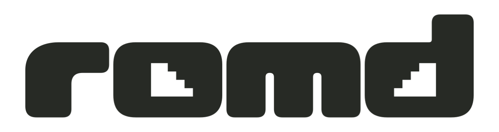
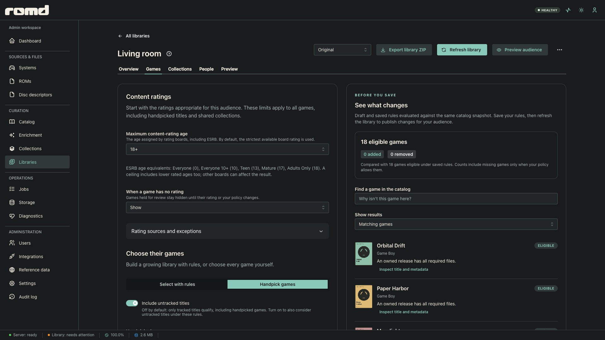
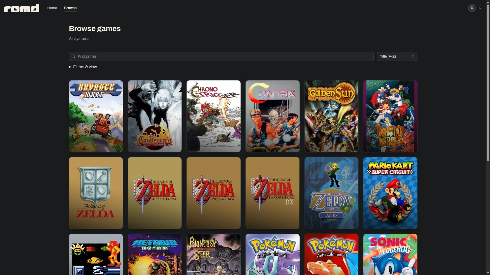

<h1 align="center">
  <picture>
    <source media="(prefers-color-scheme: dark)" srcset="brand/romd-lockup-horizontal-dark.svg">
    
  </picture>
</h1>

<strong>A self-hosted home for your personal game library.</strong>

ROMD organizes and verifies your ROM collection, fills in metadata and artwork,
and brings it to your household through personal libraries, browser playback
and a controller-first console app.

> [!NOTE]
> **Public pre-release.** Server release qualification targets Linux amd64.
> Ottercade, the console client, is experimental.

| Curate and share | Browse and play |
| --- | --- |
|  |  |

- **Keep your collection in order.** Match imports against DAT catalogs,
  verify files by checksum and store them in a content-addressed library.
- **Make it yours.** Curate metadata and artwork, build collections, and choose
  each audience's games and content-rating policy.
- **Get playing.** Download your games, play supported releases in the browser,
  or take your library to the TV with Ottercade.

## Start here

| I want to… | Read this |
| --- | --- |
| Install and operate ROMD | [Self-hosting](docs/self-hosting/README.md) |
| Add my games and set up my household | [Your first library](docs/features/first-library.md) |
| Browse, download or play | [Using the consumer portal](docs/features/browsing-and-playing.md) |
| Check what can play where | [Playback compatibility](docs/features/playback-compatibility.md) |
| Run from source or contribute | [Development setup](docs/development/getting-started.md) · [Contributing](CONTRIBUTING.md) |
| Work on a particular app | [Web workspace](web/README.md) · [Ottercade](clients/romd_console/README.md) |
| Understand the design | [Architecture](docs/README.md#architecture) · [Decisions](docs/decisions/README.md) |
| Maintain or release the project | [Maintainer guides](docs/README.md#maintainers) |

The [documentation index](docs/README.md) connects the feature guides,
configuration references and operational runbooks.
The [roadmap](ROADMAP.md) describes current scope and the next qualification milestones.

  <a href="clients/romd_console/README.md">
    <picture>
      <source media="(prefers-color-scheme: dark)" srcset="brand/ottercade/assets/logos/wordmark-reversed/logo.svg">
      
    </picture>
  </a>
   Your game library, from the couch. <a href="brand/README.md">Meet the brands.</a>

## Get involved

ROMD is maintained by one person with limited time for triage, support and
review. Bug reports and feedback are welcome; responses, fixes and feature
implementation are not guaranteed.

**External pull requests are accepted by invitation only**, including
documentation changes. Wait for an explicit maintainer invitation on a specific
issue before preparing a pull request. Unsolicited pull requests may be closed
without review. See the [contribution guide](CONTRIBUTING.md#pull-request-policy)
for the policy and workflow.

[Report a bug or suggest an idea](https://github.com/MoonlarkStudios/romd/issues/new/choose).
Report vulnerabilities privately through [Security](SECURITY.md).
Please follow the [code of conduct](CODE_OF_CONDUCT.md).

ROMD ships no ROMs, BIOS files or game content. Bring your own lawfully obtained
collection.

Copyright © 2026 Moonlark Studios LLC. [AGPL-3.0-only](LICENSE) ·
[Third-party notices](THIRD_PARTY_NOTICES.md) · [Trademarks](TRADEMARKS.md).
