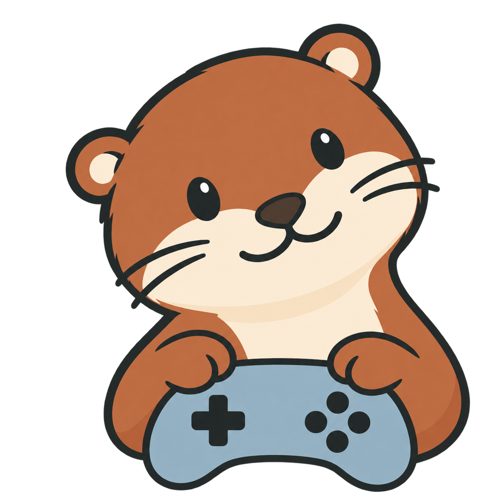

<p align="center">
  
</p>

<h1 align="center">
  <picture>
    <source media="(prefers-color-scheme: dark)" srcset="../../brand/ottercade/assets/logos/wordmark-reversed/logo.png">
    
  </picture>
</h1>

<p align="center"><strong>Your game library, from the couch.</strong></p>

Ottercade is the console app for [ROMD](../../README.md). Plug in a controller,
pick your profile, and browse, install and play the games from your ROMD
server on the big screen. Romp the otter will keep you company.

> [!NOTE]
> Ottercade is **experimental**. No native build is a supported release yet,
> and each platform needs its own build and packaged-app qualification first.

## Highlights

- **Controller-first.** Built for gamepad and keyboard navigation, with focus,
  directional movement and controller setup in the launcher.
- **Local profiles.** Everyone in the house gets a profile. Profiles work
  offline, and connecting to a ROMD server is opt-in.
- **Your library, cached locally.** Install games from your ROMD library and
  play them offline. Saves, states and play history stay separate per profile
  and per server.
- **Emulator profiles.** Launch RetroArch, DuckStation, PCSX2 and Dolphin.
  Managed provisioning and controller support depend on the native platform.

Ottercade targets macOS, Windows, Linux and Android from one Flutter codebase.

## Try it

You'll need a ROMD development stack and the console toolchain:

```sh
# From the repository root
mise run bootstrap --console
mise run dev:containers

# From clients/romd_console
mise install
mise run run:macos    # or run:linux / run:windows
```

The [development guide](docs/development.md) has the full setup, native SDK
prerequisites and every task.

## Learn more

- [Set up and use Ottercade](docs/using-ottercade.md): connect a server,
  configure a controller, install dependencies and keep your progress.
- [Playback compatibility](../../docs/features/playback-compatibility.md): browser,
  console and external-emulator scope.
- [Documentation index](docs/README.md): architecture, design system,
  decisions and roadmaps.
- [Branding](docs/branding.md): Ottercade's checked-in kit, placement and updates.
- [Client instructions](AGENTS.md): invariants to respect when changing the
  client.

## Naming

**Ottercade** is the product name. The Dart package, bundle identifiers, storage
keys and other persisted technical identifiers stay `romd_console` / `com.romd`
for compatibility. Don't rename them without a migration.

## Contributing

Read the repository's [contributing guide](../../CONTRIBUTING.md). For console
changes, run `mise run analyze` and `mise run test` from this directory.
